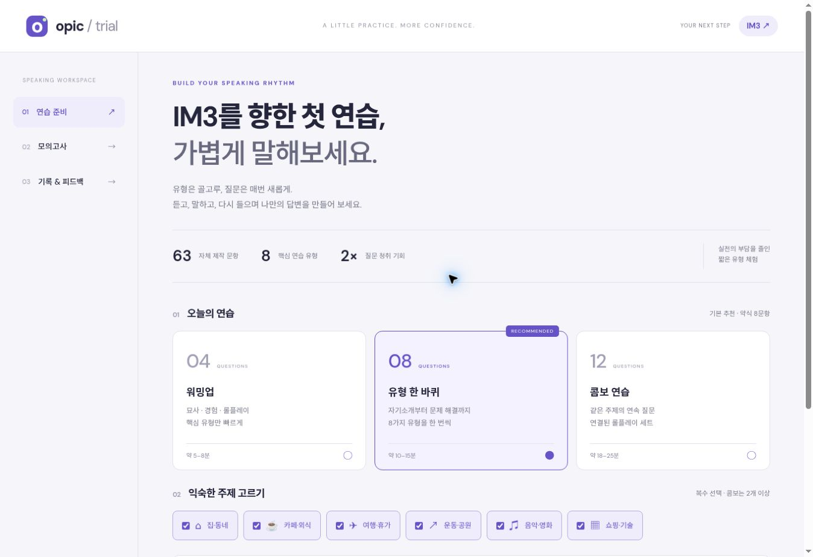

# OPIc Trial · IM3 Speaking Lab

IM3를 목표로 주요 질문 유형을 짧게 경험하는 **비공식 OPIc 연습 웹앱**입니다. 공식 시험을 복제하거나 등급을 보증하는 서비스가 아닙니다. 문제와 음성은 공식 기출·공식 녹음이 아닙니다.



## GitHub Pages 배포

빌드나 API 키 없이 저장소 루트의 `index.html`로 실행됩니다.

1. 저장소 **Settings → Pages**로 이동합니다.
2. **Build and deployment → Source: Deploy from a branch**를 선택합니다.
3. **Branch: main / Folder: /(root)**를 선택하고 **Save**합니다.
4. 배포 완료 후 `https://leetj94-lab.github.io/opic_trial/`에 접속합니다.
5. HTTPS 주소에서 영어 음성 테스트와 마이크 테스트를 진행합니다.

Pages 활성화는 사용자가 직접 진행하도록 두었습니다. 모든 프런트엔드 경로는 `./` 상대 경로이므로 `/opic_trial/` 하위 경로에서 동작합니다. `.nojekyll`이 포함되어 있습니다.

## 기능

- 자체 제작 문항 **63개**, **6개 주제**, **8가지 유형**
- 워밍업 4문항 / 유형 체험 8문항 / 콤보 연습 12문항
- 유형 체험: 자기소개 → 묘사 → 일상 → 과거 경험 → 비교 → 질문 롤플레이 → 문제 해결 → 관련 경험
- 콤보: 자기소개 + 서로 다른 두 주제의 묘사·일상·경험 세트 + 동일 상황의 롤플레이 세트 + 비교 + 관련 경험
- 선택한 주제 안에서 무작위 출제. 매 시험이 모두 다른 것을 보장하는 출제 이력 회피 방식은 아닙니다.
- 브라우저 영어 TTS로 질문 최대 2회 청취. 기본 자동 2회, 설정을 끄면 1회 + 재청취 1회
- 질문 텍스트 기본 숨김 / 수동 열기
- 답변 녹음 및 녹음 중 영어 음성인식, 인식 결과 수정
- 답변 길이 60 / 90 / 120초 권장 가이드. 강제 종료 없음
- IndexedDB에 답변·음성·평가 저장, 진행 중인 시험 이어하기, 기록 삭제
- 문항별 음성 다운로드, 텍스트·JSON 내보내기, JSON 텍스트 기록 가져오기
- 유형별 복습 체크리스트와 단어 수 등 기본 지표. 이 수치로 등급을 계산하지 않음
- **ChatGPT 평가 요청문 복사 / 다운로드**: 현재 구독으로 ChatGPT 대화에서 평가받고 결과를 앱에 붙여넣어 보관
- 별도 서버를 설정한 경우에만 선택적으로 자동 GPT 텍스트 평가

## 먼저 알아둘 기술적 제약

### 마이크·음성인식

HTTPS의 Chrome / Edge 데스크톱을 권장합니다. 마이크 권한이 필요합니다. Safari·모바일 등에서는 녹음과 음성인식의 동시 사용이 제한되거나 인식이 중단될 수 있습니다. 실제 지원 여부는 앱의 음성·마이크 테스트로 확인하세요.

- `speechSynthesis`: 기기의 설치된 영어 음성으로 질문을 읽습니다. 영어 음성이 없거나 OS 서비스가 실패하면 텍스트를 보거나 음성을 설치한 다른 기기에서 연습하세요. 공식 시험 음성이 아닙니다.
- `MediaRecorder`: 음성을 WebM/Opus, MP4 또는 브라우저가 지원하는 형식으로 녹음합니다.
- `SpeechRecognition` / `webkitSpeechRecognition`: **녹음 중 실시간 인식**입니다. 저장된 녹음 파일을 나중에 자동 전사하는 기능이 아닙니다. 네트워크 오류·인식 실패 시 녹음을 다운로드하거나 듣고 텍스트를 직접 입력하세요.
- 브라우저 제공자의 음성인식 서버로 음성이 전송될 수 있습니다. 설정에서 인식을 끌 수 있습니다. 앱 자체는 녹음을 외부 서버에 업로드하지 않습니다.
- 탭을 백그라운드로 전환하면 모바일 중단·유실을 줄이기 위해 진행 중 녹음을 마칩니다. 다른 페이지로 이동하거나 탭을 닫기 전 녹음을 먼저 종료하세요.
- 녹음 시작은 사용자가 버튼을 누르는 방식입니다. 질문 재생은 녹음과 겹치지 않습니다.

### 저장

녹음과 답변은 **현재 기기·브라우저·출처(origin)**의 IndexedDB에 보관됩니다. 계정 동기화나 서버 백업은 없습니다. 브라우저 데이터를 삭제하거나 시크릿 창을 닫으면 기록이 사라질 수 있습니다. JSON에는 음성이 포함되지 않으므로 음성은 개별 다운로드하세요. 저장소가 부족하거나 차단되면 앱에서 안내하며 다운로드로 보관할 수 있습니다.

구글 웹폰트를 불러오며 실패 시 기기 기본 글꼴로 표시합니다. 질문·텍스트 답변은 폰트 요청에 포함되지 않습니다.

### GPT 평가: 현재 구독 활용

기본 구현은 **복사 / 파일 전달 방식**입니다.

1. 연습 완료 → **ChatGPT로 평가받기**
2. 질문·답변·평가 기준이 들어 있는 요청문을 복사하거나 TXT로 다운로드
3. **ChatGPT 열기** → 본인 계정의 대화에 붙여넣거나 파일 첨부
4. 결과를 웹앱의 피드백 칸에 붙여넣고 저장

앱이 ChatGPT 대화를 자동으로 열어 프롬프트를 제출하거나 결과를 읽지는 않습니다. ChatGPT 계정 쿠키·세션 토큰을 추출하지 않습니다.

공식 문서에는 구독을 사용하는 **Sign in with ChatGPT** 오픈소스 경로가 있지만, 공개된 동적 등록 흐름은 `127.0.0.1` 콜백 수신기와 토큰 보호가 가능한 로컬 런타임을 요구합니다. 정적 GitHub Pages 웹사이트만으로 이 경로를 완성할 수 없으므로 인증된 구독 연동인 것처럼 표시하지 않았습니다. 웹 파트너 방식은 별도 등록·승인·서버 구성이 필요할 수 있으며 이 저장소에는 구현하지 않았습니다. 호스팅 위치를 Sites로 바꾸는 것만으로 구독 권한이 자동 부여되지는 않습니다.

평가 요청문은 과업 수행·구체성·문장 연결·어휘·문법·시제·롤플레이의 질문과 대안을 점검하도록 구성했습니다. 텍스트만으로 발음·억양·실제 멈춤을 평가하거나 공식 IM3 점수·합격 확률을 단정하지 않도록 지시합니다. 인식 오류 가능성도 구분하게 합니다.

## 선택: 웹에서 자동 GPT 평가

`server/worker.js`는 **별도 배포가 필요한 Cloudflare Worker 예제**입니다. GitHub Pages에서 서버 코드는 실행되지 않습니다. API 이용 설정과 요금이 별도로 적용될 수 있습니다. 이 작업에서는 API 키가 제공되지 않아 실제 OpenAI 요청과 Worker 배포는 진행하지 않았습니다.

1. Cloudflare 계정에서 Worker를 준비하고 `server/` 디렉터리에서 Wrangler를 사용합니다.
2. `wrangler.toml`의 `OPENAI_MODEL`을 본인 OpenAI API 프로젝트에서 사용 가능한 텍스트 모델 ID로 설정합니다.
3. `ALLOWED_ORIGIN`을 프런트엔드 출처로 설정합니다. GitHub Pages는 `https://leetj94-lab.github.io`입니다. `/opic_trial/` 경로는 출처에 포함하지 않습니다.
4. `npx wrangler secret put OPENAI_API_KEY`로 OpenAI API 키를 서버 비밀값에 저장합니다.
5. `npx wrangler secret put ACCESS_TOKEN`으로 충분히 긴 임의의 **별도 접근 토큰**을 저장합니다. API 키와 다른 값이어야 합니다.
6. `npx wrangler deploy`로 Worker를 배포합니다.
7. 앱 결과 화면 → **자동 GPT 평가 서버 연결**에서 Worker의 `https://...workers.dev/evaluate`와 별도 접근 토큰을 입력합니다.
8. 텍스트 전송 동의 후 평가 요청. 질문·전사 텍스트가 해당 서버와 OpenAI로 전송되며 음성은 전송되지 않습니다.

접근 토큰은 브라우저 영구 저장소에 기록하지 않습니다. 서버는 정확한 CORS 출처, 접근 토큰, 본문 크기 및 완료된 모델 응답을 확인합니다. 키·토큰을 소스나 공개 저장소에 넣지 마세요. 개인 학습 용도이며 여러 사용자에게 공개 제공하려면 사용자 인증·호출별 할당량·서버 속도 제한을 추가해야 합니다. 타임아웃은 처리 중인 상위 API 요청의 과금 취소를 보장하지 않습니다.

## 개발 및 검증

Node.js 20 이상에서 외부 의존성 없이:

```sh
npm test
npm run build
python3 -m http.server 3000
```

`http://localhost:3000`에 접속합니다. 로컬 정적 확인에는 빌드가 필요하지 않습니다. `build`는 선택적으로 배포 가능한 `dist/` 사본을 생성합니다. GitHub Pages의 기본 배포 대상은 루트입니다.

- `js/bank.js`: 문제은행 / 무작위 유형별 출제
- `js/core.js`: 지표 / 평가 요청문 / 텍스트 내보내기
- `js/store.js`: IndexedDB 저장
- `js/app.js`: 시험·음성·녹음·복습 UI
- `server/`: 별도 선택형 평가 서버
- `tests/`: 출제 다양성·주제 제한·콤보 일관성·평가 요청문·서버 인증·응답 파싱 테스트

자동 테스트는 실제 OS TTS, 마이크, 브라우저 음성인식 또는 OpenAI 과금 API에 연결하지 않습니다. 배포 후 실제 기기에서 두 번 듣기 → 녹음 → 영어 인식 → 복습 → 새로고침 후 기록 확인을 수행하세요. 원격 HTTP 미리보기에서 텍스트 답변·문항 이동·복습은 점검했지만 마이크·음성인식은 검증할 수 없었습니다.

## 기준 자료

- [OPIc 공식 시험 소개](https://www.opic.or.kr/opics/servlet/controller.opic.site.about.AboutServlet?p_process=move-introduce-opic): 12–15문항, 본 시험 40분, 질문 청취 2회
- [GitHub Pages](https://docs.github.com/en/pages/getting-started-with-github-pages/what-is-github-pages): 정적 사이트 호스팅
- [MDN SpeechRecognition](https://developer.mozilla.org/en-US/docs/Web/API/SpeechRecognition): 브라우저 지원과 서버 기반 인식 제약
- [OpenAI Sign in with ChatGPT](https://developers.openai.com/siwc/quickstart)
- [OpenAI 오픈소스 등록·로그인](https://developers.openai.com/siwc/token-sharing-open-source/sign-in)
- [OpenAI 텍스트 생성](https://developers.openai.com/api/docs/guides/text)
